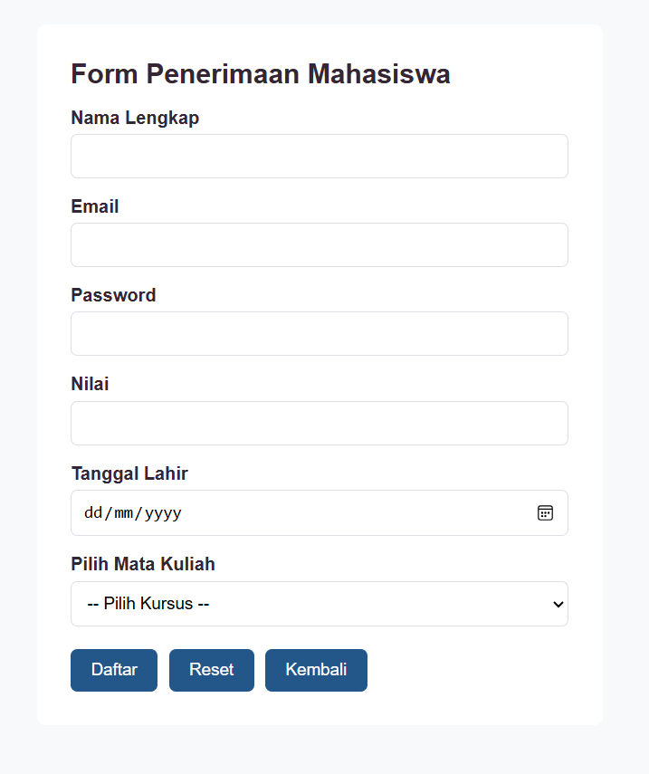

# Proyek Form Pendaftaran Kursus

Proyek ini dibuat untuk memenuhi **Tugas Individu Praktikum Desain Web - Pertemuan 6 (HTML Form Dasar, Input & Pengiriman Data)**, yaitu membuat form pendaftaran kursus dengan minimal lima tipe input dan tiga jenis button, serta label yang terhubung dengan setiap kontrol, menggunakan HTML dan CSS sederhana.

## Struktur File
1. `index.html` : Berisi kerangka halaman form pendaftaran kursus beserta seluruh kontrol input dan button.
2. `css/style.css` : Berisi gaya visual form (warna, jarak, tampilan input, dan tombol).
3. `README.md` : Dokumentasi singkat penjelasan hasil output program.

## Penjelasan Hasil Output & Fungsi Tiap Bagian
Halaman web ini berisi satu form dengan bagian-bagian berikut:
1. **Judul Form**: Menampilkan judul `Form Pendaftaran Kursus` sebagai identitas halaman.
2. **Kolom Input Data Diri**: Terdiri dari lima tipe input berbeda:
   * `text` untuk **Nama Lengkap**, menerima teks umum.
   * `email` untuk **Email**, dengan bantuan validasi format email dari browser.
   * `password` untuk **Password**, karakter yang diketik disamarkan di layar.
   * `number` untuk **Umur**, hanya menerima angka (10-80).
   * `date` untuk **Tanggal Lahir**, menampilkan kontrol tanggal sesuai browser.
3. **Pilihan Kursus**: Menu `select` untuk memilih kursus (`Desain Web`, `Pemrograman Python`, atau `Basis Data`).
4. **Kelompok Button**: Terdiri dari tiga jenis button:
   * `submit` (**Daftar**) untuk mengirim data form.
   * `reset` (**Reset**) untuk mengosongkan kembali seluruh isian form.
   * `button` (**Kembali**) berupa tombol biasa yang tidak mengirim form kecuali diberi perilaku JavaScript.

## Penerapan Konsep Materi
* **Label & aksesibilitas**: Setiap `<label>` dihubungkan dengan kontrolnya melalui atribut `for` yang sama dengan `id`, sehingga area klik lebih luas dan mudah dipahami pembaca layar.
* **Atribut `name`**: Setiap kontrol memiliki atribut `name` sebagai nama key saat data dikirim.
* **Action & method**: Form memakai `action="/proses-pendaftaran"` dan `method="post"` karena data pendaftaran dikirim melalui body request. Data belum diproses karena belum ada backend.

## Tampilan pada Berbagai Ukuran Layar
Lebar form menyesuaikan ukuran layar (90% lebar layar dengan batas maksimal 500px), sehingga tetap nyaman dibaca di desktop maupun ponsel.

## Cara Menjalankan Program
1. Simpan file `index.html` dan folder `css` (berisi `style.css`) di dalam satu folder yang sama.
2. Klik dua kali pada file `index.html` untuk membukanya di browser.
3. Isi form, lalu coba tombol **Reset** untuk mengosongkan isian. Tombol **Daftar** akan mengirim data ke `/proses-pendaftaran`, yang belum tersedia sebelum ada backend.

# Output

