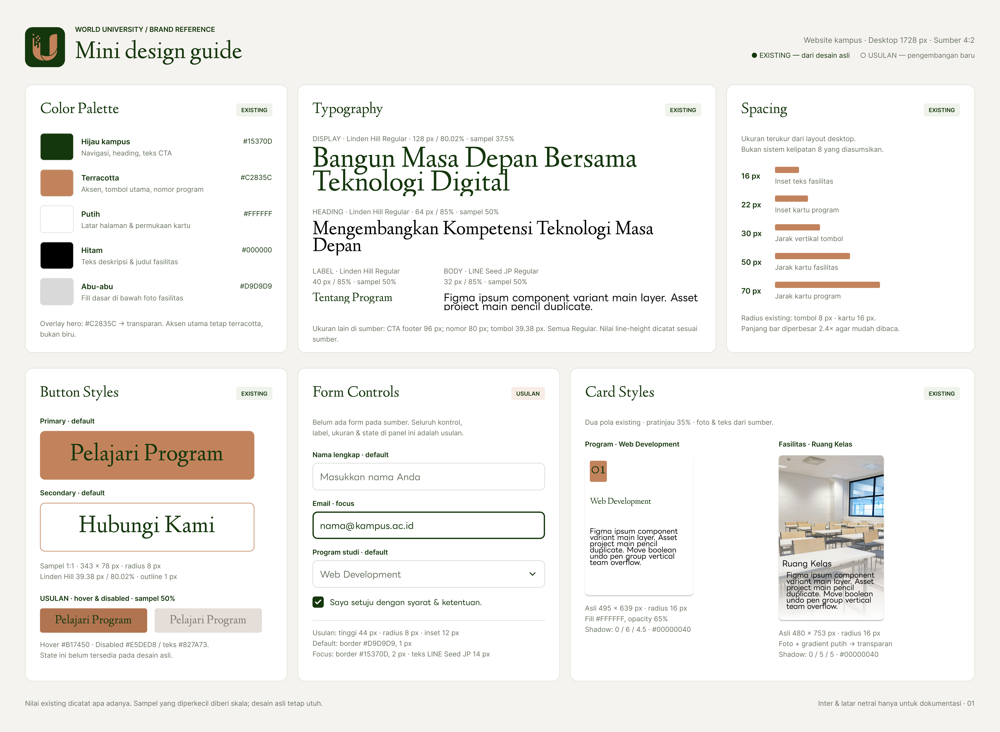

# Design Web — World University

Proyek perancangan antarmuka (UI/UX) untuk landing page **World University**. Desain dikembangkan menggunakan Figma yang mencakup perancangan wireframe struktural, panduan sistem desain (mini design guide), hingga implementasi *high-fidelity mockup* responsif (Desktop & Mobile).

---

## 1. Panduan Desain (Mini Design Guide)

Dokumentasi standarisasi visual dan komponen UI yang digunakan sebagai acuan pengembangan antarmuka:

* **Color Palette:**
  * **Hijau Kampus (`#15370D`)**: Digunakan untuk navigasi header, heading utama, dan latar belakang section penutup (CTA).
  * **Terracotta (`#C2835C`)**: Aksen utama, nomor urut program, serta tombol aksi primer (*Primary Button*).
  * **Putih (`#FFFFFF`)**: Latar belakang halaman dan permukaan kartu konten.
  * **Hitam (`#000000`)**: Teks deskripsi dan judul fasilitas.
  * **Abu-abu (`#D9D9D9`)**: Border elemen dan *fill* dasar.
* **Typography:**
  * **Linden Hill Regular**: Digunakan untuk *Display*, *Heading*, dan label aksen.
  * **LINE Seed JP Regular**: Digunakan untuk teks *Body* / paragraf agar nyaman dibaca.
* **Spacing & Radius:**
  * Inset dan margin: 16px, 22px, 30px, 50px, hingga 70px.
  * Corner radius: 8px (tombol & input) dan 16px (kartu informasi).
* **Komponen:**
  * *Buttons*: Primary (*Pelajari Program*) dan Secondary (*Hubungi Kami*).
  * *Cards*: Kartu Program Studi (Web Development, Software Development, Data & Technology) dan Kartu Fasilitas.
  * *Form Controls*: Standarisasi input teks, dropdown, dan checkbox.

---

## 2. Wireframe Desktop

Wireframe desktop berfokus pada penyusunan tata letak (layout) dan hierarki informasi sebelum penerapan visual detail:

* **Header & Navigasi**: Logo World University serta menu navigasi (*Beranda, Tentang, Fasilitas, Kontak*).
* **Hero Section**: *Headline* utama "Bangun Masa Depan Bersama Teknologi Digital", deskripsi pengantar, placeholder gambar kampus, dan dua tombol aksi (CTA).
* **Section Tentang Program**: *Subheading* pengenalan kompetensi teknologi masa depan dan 3 kartu program bernomor (01, 02, 03).
* **Section Fasilitas**: Grid 3 kolom untuk fasilitas kampus (Ruang Kelas, Laboratorium, Kelas Utama).
* **Footer / CTA**: Banner penutup "Siap Untuk Masa Depan Anda?" dengan tombol *Hubungi Kami*.

---

## 3. High-Fidelity Mockup Desktop

Mockup desktop merupakan implementasi visual penuh dengan menerapkan warna brand (*Hijau Kampus* dan *Terracotta*), tipografi terpilih, aset foto nyata, serta efek kedalaman visual:

* **Hero Banner**: Foto kampus dipadukan dengan aksen lengkungan hijau dan tipografi serif yang elegan.
* **Bagian Program**: Kartu dengan background putih berbayang halus (*soft shadow*) dan badge nomor Terracotta.
* **Bagian Fasilitas**: Kartu dengan foto dokumentasi fasilitas modern (Ruang Kelas, Laboratorium Komputer, dan Kelas Utama/Auditorium).
* **Section Penutup**: Latar hijau tua dengan kurva dinamis yang memperkuat identitas visual World University.

---

## 4. Wireframe Mobile

Rancangan tata letak untuk perangkat bergerak (*mobile viewport*) yang mengadaptasi struktur desktop ke dalam format ringkas:

* Navigasi disesuaikan agar hemat ruang pada layar ponsel.
* Hero section disusun secara vertikal (judul, placeholder gambar, deskripsi, lalu tombol CTA).
* Kartu program dan fasilitas diubah dari tata letak multi-kolom menjadi tumpukan vertikal (*single column*).
* Tombol CTA diperlebar (*full-width*) agar mudah dijangkau oleh ibu jari pengguna (*thumb-friendly*).

---

## 5. High-Fidelity Mockup Mobile

Penerapan visual akhir pada tampilan mobile dengan mempertahankan konsistensi gaya desain desktop:

* Proporsi teks dan elemen grafis diskalakan agar tetap proporsional dan mudah dibaca pada layar kecil.
* Alur pembacaan konten mengalir secara linier dari atas ke bawah tanpa memotong hierarki informasi.
* Mempertahankan kontras warna yang optimal untuk keterbacaan di berbagai kondisi pencahayaan layar ponsel.

---

## Kesimpulan

Proses perancangan mencakup transisi dari struktur wireframe menuju representasi *high-fidelity* yang didukung oleh sistem desain yang terukur. Pendekatan responsif memastikan informasi akademis World University dapat diakses secara optimal, konsisten, dan nyaman baik melalui perangkat desktop maupun mobile.